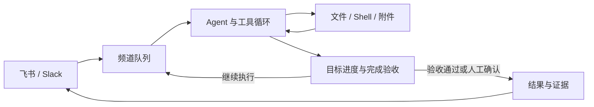

# LightClaw

**在飞书和 Slack 中执行任务，保存进度，并核验完成结果。**

[English](packages/lightclaw/README.md) · [使用指南](packages/lightclaw/README.zh-CN.md) · [架构](packages/lightclaw/docs/architecture.zh-CN.md) · [目标验收](packages/lightclaw/docs/goals.zh-CN.md)

LightClaw 是一个基于 TypeScript 的自托管个人 Agent。你在聊天中交付目标，它调用文件和 Shell 工具完成工作，将进度保存到磁盘，并在完成前检查文件、运行验收命令，或等待创建者确认。

适合需要多轮执行、保留产物和追踪过程的任务：整理资料、生成报告、修改代码、运行测试，以及定时处理工作区内的文件。


## 当前交付状态

最终目标是单实例、同一信任域的个人Agent：飞书优先，保留Slack接入；通过文件和Shell工具完成任务，保存对话、目标和产物，支持受控执行、恢复与备份。项目功能收敛，开始按[学习路线](packages/lightclaw/docs/learning-path.zh-CN.md)阅读源码。

当前采用源码启动。飞书私聊与提示词交互已有用户实际使用；工程回归与静态检查用于保障功能，不开展Agent效果评测。评测框架、数据集、候选筛选CLI和性能基准已删除；历史记录保留在docs/history与既有证据目录。模型与平台表现受环境影响，不承诺任务必然成功；本轮已在隔离副本完成5包构建、独立安装及有限飞书私聊/模型验收，未开展完整跨平台线上验收。详见docs/reports/FINAL-ACCEPTANCE-2026-11-06.zh-CN.md。

[最终范围与完成清单](packages/lightclaw/docs/project-scope.zh-CN.md) · [部署与备份恢复](packages/lightclaw/docs/deployment.zh-CN.md) · [故障排查](packages/lightclaw/docs/troubleshooting.zh-CN.md) · [资源策略](packages/lightclaw/docs/resources.zh-CN.md)

`--help`无需凭证；`--health=<工作目录> --control=<控制目录>`分别报告锁、进程、运行时就绪与SDK连接状态；不主动连接平台或模型。Node Agent运行于宿主，Docker仅执行工具；正常退出收敛后才释放锁，异常执行进入unknown等待人工核对，不能因锁文件存在就删除它。

## 为什么用 LightClaw

| 能力 | 解决的问题 | 实现方式 |
| --- | --- | --- |
| 持久化目标 | 任务需要多轮推进，进程可能中断 | 保存状态与进度，支持暂停、恢复、取消和重启恢复 |
| 完成验收 | 模型说“完成”后，还需要检查结果 | 创建时固定文件／命令规则；自然语言目标由创建者确认 |
| 受控执行 | 工具调用可能超时、失败或持续循环 | 单轮时间、工具和 Token 阈值；失败与停滞熔断 |
| 多频道调度 | 同一频道的请求需要有序处理 | 频道队列、排队期限、容量限制和空闲缓存回收 |
| 工具沙箱 | 文件与 Shell 操作需要限制影响范围 | 可选 Docker 执行环境，配置 CPU、内存、进程数和网络 |
| 可检查的运行过程 | 需要知道一次任务做了什么、花了多少资源 | JSONL审计、工具判定与退出码、运行用量及结果通知 |

飞书和 Slack 共用一套 `ChatTransport` 接口。模型、工具、会话和上下文管理复用 [pi-mono](https://github.com/badlogic/pi-mono)；LightClaw 的业务代码集中在 [`packages/lightclaw`](packages/lightclaw)。

## 一次任务如何完成



例如，在飞书中发送：

```text
/goal 读取 scratch/notes.md，整理成 scratch/report.md，并附上结果文件
/goal status
```

Agent 可以多轮读取、写入和检查产物。自然语言目标提交完成申请后暂停推进，创建者使用 `/goal status` 中的 `/goal confirm <goalId> <attemptId>` 确认本次结果。

如果完成条件可以写成规则，可在创建时指定自动验收：

```text
/goal create {"objective":"根据 notes.md 生成报告","acceptance":{"files":[{"path":"scratch/report.md","contains":["结论"],"changed":true}]}}
```

验收器检查产物内容及相对创建基线的变化。Docker 模式还支持重新执行测试命令，详见[目标验收说明](packages/lightclaw/docs/goals.zh-CN.md)。

## 快速开始

需要 **Node.js >= 22.19.0**、npm、可用的模型凭证，以及飞书或 Slack 应用。以下步骤使用 Docker 运行工具，Node Agent 在宿主机运行。

### 1. 安装并创建工具环境

```bash
git clone https://github.com/Xxly959/Light-Claw.git
cd Light-Claw
npm install
mkdir -p lightclaw-data
bash packages/lightclaw/docker.sh create ./lightclaw-data
```

### 2. 配置模型与聊天平台

以下使用仓库默认的 `zai/glm-5.3-flash`。provider 与 model ID 必须存在于 pi 的模型注册表中；OpenAI 兼容网关可通过 `OPENAI_BASE_URL` 覆盖地址。

```bash
export LIGHTCLAW_MODEL_PROVIDER=zai
export LIGHTCLAW_MODEL_ID=glm-5.3-flash
export OPENAI_API_KEY='your-api-key'
# 使用自定义 OpenAI 兼容网关时设置：
# export OPENAI_BASE_URL='https://your-gateway.example/v1'

export LIGHTCLAW_TRANSPORT=feishu
export LIGHTCLAW_FEISHU_APP_ID='cli_xxx'
export LIGHTCLAW_FEISHU_APP_SECRET='your-app-secret'
```

飞书应用需开启机器人能力，使用长连接订阅 `im.message.receive_v1`，并具备读取和发送消息的权限。私聊直接发送，群聊 @ 机器人。

<details>
<summary>改用 Slack</summary>

开启应用的 Socket Mode，按 [Slack 接入指南](packages/lightclaw/docs/slack-bot-minimal-guide.md) 配置事件和权限，再替换聊天平台变量：

```bash
export LIGHTCLAW_TRANSPORT=slack
export LIGHTCLAW_SLACK_APP_TOKEN='xapp-xxx'
export LIGHTCLAW_SLACK_BOT_TOKEN='xoxb-xxx'
```

</details>

### 3. 启动并发送任务

```bash
npx tsx packages/lightclaw/src/main.ts \
  --sandbox=docker:lightclaw-sandbox \
  ./lightclaw-data
```

先发送一条普通消息验证连接，再尝试 `/goal`。凭证通过环境变量或 pi 认证存储读取；启动入口不会自动加载 `.env`。

省略 `--sandbox` 会使用宿主机执行。Docker 默认网络为 `bridge`；离线工具环境可在创建容器前设置 `LIGHTCLAW_SANDBOX_NETWORK=none`。详细参数见[沙箱说明](packages/lightclaw/docs/sandbox.zh-CN.md)。

## 目标控制与执行边界

```text
/goal status     查看目标、进展与待确认结果
/goal pause      暂停目标
/goal resume     恢复目标
/goal cancel     取消目标
```

默认目标上限为 8 轮；连续失败或停滞达到 2 轮时暂停。单轮默认 5 分钟、100 次工具调用和 100,000 个已报告 Token，均可通过环境变量配置。Token 阈值在收到用量报告后生效，不能作为账单硬上限。

目标控制状态保存在工作区外；对话、记忆、附件和产物按频道组织在 `lightclaw-data/` 中。排队记录可恢复；执行结果不确定的任务进入unknown并阻止自动重放，受控服务可按稳定operation ID对账，任意bash仍需人工核对副作用。当前设计面向单实例个人 Agent，详见[使用指南](packages/lightclaw/README.zh-CN.md)。

## 权限与执行配置

默认配置保持既有行为；以下开关用于满足安全评审，缺省值不会改变现有部署：

| 变量 | 作用 | 缺省 |
| --- | --- | --- |
| `LIGHTCLAW_TRUSTED_USER_IDS` | 可信用户名单；名单外用户触发的 run 在执行/外发前需要审批 | 空（全部可信） |
| `LIGHTCLAW_CHANNEL_POLICY_JSON` | 频道能力策略，如 `{"default":{"caps":["fs:read"]}}` | 全量能力 |
| `LIGHTCLAW_CHANNEL_POLICY_MAP_JSON` | 频道到策略的映射，如 `{"C123":"readonly"}` | 无 |
| `LIGHTCLAW_POLICY_MODE` | `enforce` / `off`（应急回滚，仍写审计摘要） | `enforce` |
| `LIGHTCLAW_AUDIT_PAYLOAD_MODE` | `off` / `digest` / `full`（原文落盘） | `digest` |
| `LIGHTCLAW_APPROVAL_TTL_MS` | 审批票据有效期 | 30 分钟 |
| `LIGHTCLAW_MODEL_FALLBACKS` | 主备降级，形如 `provider/model,provider/model` | 无 |
| `LIGHTCLAW_OTLP_ENDPOINT` | span 推送地址（OTLP/JSON） | 无 |
| `LIGHTCLAW_CHANNEL_CONTAINERS_JSON` | 频道到专属容器的映射 | 无（共用容器） |
| `LIGHTCLAW_SANDBOX_FALLBACK` | `shared` / `deny`：未配置专属容器时共享还是拒绝 | `shared` |

默认所有频道共用一个容器的 `/workspace`，因而彼此可读。需要真正隔离时，为频道单独建容器：

```bash
bash packages/lightclaw/docker.sh create-channel ./lightclaw-data <频道ID>
export LIGHTCLAW_CHANNEL_CONTAINERS_JSON='{"<频道ID>":"lightclaw-chan-<频道ID>"}'
```

该容器只挂载 `lightclaw-data/<频道ID> → /workspace/<频道ID>`，启动时会校验挂载契约，多挂任何目录都拒绝启动。代价是频道容器内看不到工作区根的全局 `MEMORY.md`、`skills/`、`events/`；需要共享素材时创建 `lightclaw-data/.shared`，它会以只读方式挂到 `/workspace/.shared`。隔离模式下系统提示会同步声明写边界（只能写频道目录），避免模型反复尝试不可写路径。

高危操作（递归删除、强制推送、下载即执行、提权、访问凭据文件等）会在执行前生成一次性票据并阻断本次调用；创建者或管理员发送 `/approve <id>` 后**自动续跑并重试同一操作**，票据只能使用一次，参数变化会重新拦截。

审计分两级：`<控制目录>/.audit/tool-calls.jsonl` 始终写入脱敏摘要（工具、目标、判定、退出码、耗时）；参数原文只在 `LIGHTCLAW_AUDIT_PAYLOAD_MODE=full` 时写入 `<控制目录>/.audit/payloads/`，权限 `0600`。查询用 `lightclaw-audit`：

```bash
npx tsx packages/lightclaw/src/audit/cli.ts ./lightclaw-data --last 20
npx tsx packages/lightclaw/src/audit/cli.ts ./lightclaw-data --blocked
npx tsx packages/lightclaw/src/audit/cli.ts ./lightclaw-data --tool bash --json
```

`--isolation-report <工作目录>` 输出当前隔离等级（`shared-workspace` / `per-channel-container` / `host-unconfined`）与风险清单，用于评审而非替代评审；与 `--help` 一样不需要平台凭证，缺凭证时只读非凭证配置。设计与实施边界见[企业化加固](packages/lightclaw/docs/enterprise-hardening.zh-CN.md)。

## 提示词预览

飞书发送 `任务入口` 或 `/prompt-entry`，打开“输入任务”。原文发送直接执行；“优化并预览”在独立临时请求中生成候选并检查约束，显示修改说明、假设与待确认信息。编辑后点击“确认发送”，只有最终文本进入主Agent会话。原文与优化过程仍在控制目录留作去重记录，不是零落盘。群成员可见卡片，不要输入密钥。

## 从源码启动

```bash
cp packages/lightclaw/config.env.example .env
# 在本地编辑.env：填入飞书应用凭证、模型provider/ID和对应API key
bash scripts/start-lightclaw.sh
```

模板默认host模式，工具使用当前OS用户权限；需要Docker时先创建容器并将 `LIGHTCLAW_SANDBOX` 改为 `docker:lightclaw-sandbox`。启动器会读取.env，直接调用main.ts则只读进程环境。已有.env无需覆盖。自定义网关模型用 `LIGHTCLAW_MODELS_FILE`，见部署说明。

## 项目结构与文档

| 路径 | 用途 |
| --- | --- |
| [`packages/lightclaw`](packages/lightclaw) | 平台接入、目标、队列、沙箱、提示词预览与审计 |
| [`packages/ai`](packages/ai) | 模型接口与流式事件 |
| [`packages/agent`](packages/agent) | Agent 工具循环 |
| [`packages/coding-agent`](packages/coding-agent) | 会话、上下文压缩与工具基础设施 |
| [`packages/tui`](packages/tui) | coding-agent 所依赖的终端组件 |

- [中文使用指南](packages/lightclaw/README.zh-CN.md) / [English guide](packages/lightclaw/README.md)
- [学习路线](packages/lightclaw/docs/learning-path.zh-CN.md) · [最终范围](packages/lightclaw/docs/project-scope.zh-CN.md)
- [架构设计](packages/lightclaw/docs/architecture.zh-CN.md) · [目标状态与验收](packages/lightclaw/docs/goals.zh-CN.md)
- [沙箱配置](packages/lightclaw/docs/sandbox.zh-CN.md) · [定时事件](packages/lightclaw/docs/events.md)

## 开发检查

在仓库根目录执行 `npm run check` 进行静态检查；该命令不运行测试。定向测试从相应包目录执行，遵循 [开发规则](AGENTS.md)。

## 许可证与致谢

[MIT](LICENSE)。LightClaw 基于 [pi-mono](https://github.com/badlogic/pi-mono)，保留上游版权声明与历史。感谢 pi 提供模型、Agent 和会话基础设施。
