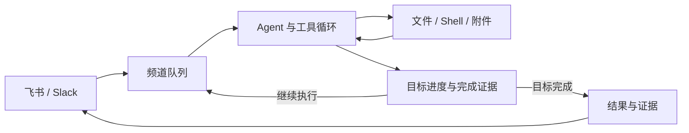

# LightClaw

**在飞书和 Slack 中执行任务，保存进度，并提供完成证据。**

[English](packages/lightclaw/README.md) · [使用指南](packages/lightclaw/README.zh-CN.md) · [架构](packages/lightclaw/docs/architecture.zh-CN.md) · [长期目标](packages/lightclaw/docs/goals.zh-CN.md)

LightClaw 是一个基于 TypeScript 的自托管个人 Agent。你在聊天中交付目标，它调用文件和 Shell 工具完成工作，将进度保存到磁盘，并在标记目标完成时提交结构化说明和证据。

适合需要多轮执行、保留产物和追踪过程的任务：整理资料、生成报告、修改代码、运行测试，以及定时处理工作区内的文件。

## 为什么用 LightClaw

| 能力 | 解决的问题 | 实现方式 |
| --- | --- | --- |
| 持久化目标 | 任务需要多轮推进，进程可能中断 | 保存状态与进度，支持暂停、恢复、取消和重启恢复 |
| 完成证据 | 需要追踪 Agent 为什么认为任务完成 | `goal_complete` 要求提交完成说明和证据，保存为结构化状态 |
| 循环熔断 | 长任务可能反复失败或停止取得进展 | 最大轮次、连续失败、连续停滞三类停止条件 |
| 多平台接入 | 希望在日常聊天工具中交付任务 | 飞书与 Slack 适配同一接口，按频道保存会话与任务 |
| 工具沙箱 | 文件与 Shell 操作需要限制影响范围 | 可选 Docker 执行环境，配置 CPU、内存、进程数和网络 |
| 可检查的运行过程 | 需要知道任务产物与资源消耗 | JSONL 审计，检查回复、文件、工具错误、耗时与 Token 的任务评测 |

飞书和 Slack 共用一套 `ChatTransport` 接口。模型、工具、会话和上下文管理复用 [pi-mono](https://github.com/badlogic/pi-mono)；LightClaw 的业务代码集中在 [`packages/lightclaw`](packages/lightclaw)。

## 一次任务如何完成



例如，在飞书中发送：

```text
/goal 读取 scratch/notes.md，整理成 scratch/report.md，并附上结果文件
/goal status
```

Agent 可以多轮读取、写入和检查产物。每轮通过 `goal_progress` 保存进展；完成时通过 `goal_complete` 提交说明和证据。你可以用 `/goal status` 查看状态，或暂停、恢复和取消目标。

当前完成证据由执行 Agent 提交，不是独立验收器的核验结果。对结果有严格要求时，应另外检查实际文件或测试输出。详见[长期目标说明](packages/lightclaw/docs/goals.zh-CN.md)。

## 快速开始

需要 **Node.js >= 22.19.0**、npm、可用的模型凭证，以及飞书或 Slack 应用。以下步骤使用 Docker 运行工具，Node Agent 在宿主机运行。

### 1. 安装并创建工具环境

```bash
git clone https://github.com/Xxly959/Light-Claw.git
cd Light-Claw
npm install
mkdir -p lightclaw-data
bash packages/lightclaw/docker.sh create ./lightclaw-data
```

### 2. 配置模型与聊天平台

以下使用仓库默认的 `zai/glm-5.3-flash`。provider 与 model ID 必须存在于 pi 的模型注册表中；OpenAI 兼容网关可通过 `OPENAI_BASE_URL` 覆盖地址。

```bash
export LIGHTCLAW_MODEL_PROVIDER=zai
export LIGHTCLAW_MODEL_ID=glm-5.3-flash
export OPENAI_API_KEY='your-api-key'
# 使用自定义 OpenAI 兼容网关时设置：
# export OPENAI_BASE_URL='https://your-gateway.example/v1'

export LIGHTCLAW_TRANSPORT=feishu
export LIGHTCLAW_FEISHU_APP_ID='cli_xxx'
export LIGHTCLAW_FEISHU_APP_SECRET='your-app-secret'
```

飞书应用需开启机器人能力，使用长连接订阅 `im.message.receive_v1`，并具备读取和发送消息的权限。私聊直接发送，群聊 @ 机器人。

<details>
<summary>改用 Slack</summary>

开启应用的 Socket Mode，按 [Slack 接入指南](packages/lightclaw/docs/slack-bot-minimal-guide.md) 配置事件和权限，再替换聊天平台变量：

```bash
export LIGHTCLAW_TRANSPORT=slack
export LIGHTCLAW_SLACK_APP_TOKEN='xapp-xxx'
export LIGHTCLAW_SLACK_BOT_TOKEN='xoxb-xxx'
```

</details>

### 3. 启动并发送任务

```bash
npx tsx packages/lightclaw/src/main.ts \
  --sandbox=docker:lightclaw-sandbox \
  ./lightclaw-data
```

先发送一条普通消息验证连接，再尝试 `/goal`。凭证通过环境变量或 pi 认证存储读取；启动入口不会自动加载 `.env`。

省略 `--sandbox` 会使用宿主机执行。Docker 默认网络为 `bridge`；离线工具环境可在创建容器前设置 `LIGHTCLAW_SANDBOX_NETWORK=none`。详细参数见[沙箱说明](packages/lightclaw/docs/sandbox.zh-CN.md)。

## 目标控制与执行边界

```text
/goal status     查看目标、进展与待确认结果
/goal pause      暂停目标
/goal resume     恢复目标
/goal cancel     取消目标
```

默认目标上限为 8 轮；连续失败或停滞达到 2 轮时暂停，可通过环境变量调整：

```bash
export LIGHTCLAW_GOAL_MAX_CYCLES=8
export LIGHTCLAW_GOAL_MAX_FAILURES=2
export LIGHTCLAW_GOAL_MAX_STALE_CYCLES=2
```

目标保存在频道目录的 `goal.json`，对话、记忆、附件和产物保存在 `lightclaw-data/`。恢复采用至少一次执行语义，外部副作用仍需业务幂等处理。当前设计面向单实例个人 Agent，详见[使用指南](packages/lightclaw/README.zh-CN.md)。

## 评测与提示词优化

评测运行实际 Agent 循环，检查回复内容、文件产物、工具错误和耗时，并记录 Token 与费用：

```bash
npx tsx packages/lightclaw/src/evals/cli.ts \
  --sandbox=docker:lightclaw-sandbox \
  --workspace=./lightclaw-data
```

提示词优化先运行基线，再生成候选并在同一数据集上评测，仅在得分严格提高时保存新指令：

```bash
npx tsx packages/lightclaw/src/evals/optimize-cli.ts \
  --sandbox=docker:lightclaw-sandbox \
  --workspace=./lightclaw-data \
  --candidates=2
```

以上命令会消耗配置模型的 API 额度。随包两例数据集用于冒烟检查；同集得分提高不代表独立测试集泛化，也不代表生产可靠性。详见[历史评测记录](packages/lightclaw/docs/evaluation.zh-CN.md)。

## 项目结构与文档

| 路径 | 用途 |
| --- | --- |
| [`packages/lightclaw`](packages/lightclaw) | 平台接入、目标、队列、沙箱、审计与评测 |
| [`packages/ai`](packages/ai) | 模型接口与流式事件 |
| [`packages/agent`](packages/agent) | Agent 工具循环 |
| [`packages/coding-agent`](packages/coding-agent) | 会话、上下文压缩与工具基础设施 |
| [`packages/tui`](packages/tui) | coding-agent 所依赖的终端组件 |

- [中文使用指南](packages/lightclaw/README.zh-CN.md) / [English guide](packages/lightclaw/README.md)
- [架构设计](packages/lightclaw/docs/architecture.zh-CN.md) · [目标状态与恢复](packages/lightclaw/docs/goals.zh-CN.md)
- [沙箱配置](packages/lightclaw/docs/sandbox.zh-CN.md) · [定时事件](packages/lightclaw/docs/events.md)
- [评测记录](packages/lightclaw/docs/evaluation.zh-CN.md)

## 开发检查

在仓库根目录执行 `npm run check` 进行静态检查；该命令不运行测试。定向测试从相应包目录执行，遵循 [开发规则](AGENTS.md)。

## 许可证与致谢

[MIT](LICENSE)。LightClaw 基于 [pi-mono](https://github.com/badlogic/pi-mono)，保留上游版权声明与历史。感谢 pi 提供模型、Agent 和会话基础设施。
