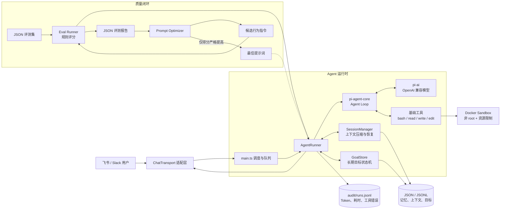

# LightClaw 架构说明

## 主调用链



实线表示线上请求或状态读写，虚线表示经过评测门禁后才允许进入运行时的提示词。核心原则是：模型负责决策，确定性代码负责状态、安全边界和验收。

## 为什么需要传输层

飞书用 message ID，Slack 用时间戳；飞书的文件、回复线程和消息编辑限制也与 Slack 不同。如果 Agent 逻辑直接依赖某个平台，增加新平台时就要复制整套业务代码。

`ChatTransport` 只保留 Agent 真正需要的最小能力：发送、更新、回复、删除、上传文件、查询用户和入队事件。Slack 与飞书分别实现它，`main.ts` 不再关心 SDK 细节。这就是适配器模式，也是依赖倒置的一个小例子。

## Agent Loop

单轮执行可以概括为：

```text
用户消息 → 模型判断 → 调用工具 → 工具结果返回模型 → 最终回复
```

如果模型继续调用工具，`pi-agent-core` 会留在循环中。如果模型不再调用工具，一轮执行结束。LightClaw 的长期目标执行器位于这个循环外面：目标未完成时，它生成一条内部续跑消息，再启动下一轮。

## Memory 与 Context

- `log.jsonl` 是便于检索的聊天历史。
- `context.jsonl` 是模型实际使用的结构化上下文。
- `MEMORY.md` 保存跨会话仍有价值的偏好和事实。
- `goal.json` 只保存当前目标的结构化状态，不依赖对话摘要。

把目标状态从模型上下文中独立出来非常重要。即使旧对话被压缩，目标、轮次、进展和证据仍不会丢失。

## 安全边界

LightClaw 默认推荐 Docker 沙箱。长期 Agent 比普通聊天机器人风险更高，因为它能多轮调用 bash 和文件工具。循环必须受到最大轮次、连续失败和无进展检测约束，用户也可以随时发送 `stop`。

审计日志只保存指标，不保存完整提示词、工具参数和回复正文。凭证只从环境变量或 pi 的认证存储读取。
