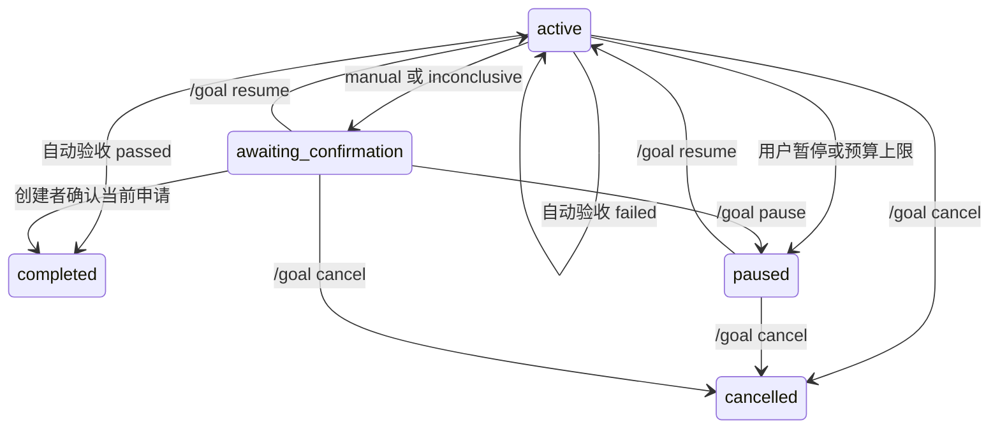

# 长期目标与完成验收

## 创建与控制

自然语言目标使用人工验收：

```text
/goal 调研方案并生成报告
/goal status
/goal pause
/goal resume
/goal cancel
```

文件或代码任务可创建固定验收契约：

```text
/goal create {"objective":"生成报告","acceptance":{"files":[{"path":"scratch/report.md","contains":["结论"],"changed":true}]}}
/goal create {"objective":"修复解析器","acceptance":{"files":[{"path":"scratch/parser.ts"}],"commands":[{"command":"python scratch/check.py","sourcePaths":["scratch/parser.ts","scratch/check.py"],"stdoutIncludes":["OK"]}]}}
```

契约由真实平台用户创建，模型只能读取。文件路径相对当前频道目录；默认 `changed:true`，与创建时实际 SHA-256 比较。`changed:false` 允许已有文件。最多16个文件、4条命令；每条命令最多16个源码路径、4096字符。命令验收仅支持 Docker，执行目录为 `/workspace/<channel>`。验收会重新执行命令，应选择可重复的测试命令；源码快照保证检查与记录版本一致，不保证测试本身正确。

## 状态机



`goal_complete` 提交摘要、证据与结构化交付物，非空“测试通过”不会直接完成目标。宿主机验证实际文件存在、内容及创建基线变化，或实际命令退出码和可选标准输出。普通读取上限10 MiB，内容匹配上限1 MiB；符号链接、目录、FIFO和设备文件不作为有效产物。读取期间以及提交前复查路径身份、inode/device、SHA-256；变化会阻止自动提交。

自动检查失败保持 active，不增加进展版本、不重置无进展计数；无法确定或人工任务进入 `awaiting_confirmation`，停止后台续跑并阻止新目标覆盖。`/goal status` 展示摘要、原因码及确认命令：

```text
/goal confirm <goalId> <attemptId>
```

只有目标创建者的真实平台消息能确认当前申请；调度、恢复、续跑事件不能创建契约或确认。人工申请必须声明 `deliverables:{kind:"files",paths:["scratch/report.md"]}`，或明确 `deliverables:{kind:"none",reason:"仅交付解释"}`，不能从 evidence 猜路径。确认时复查申请绑定的路径、SHA-256、大小、device/inode和mtime/ctime。确认默认30分钟有效，可配 `LIGHTCLAW_GOAL_CONFIRMATION_TTL_MS`。过期或产物变化后可重新申请，旧 attempt ID 不再可用。恢复、暂停、取消或新的申请会使旧确认失效；产物已变化时先 `/goal resume` 重新验收。

每目标保留最近20次验证报告与20条证据。报告记录申请ID、状态版本、每项结果、源码/产物快照和输出预览哈希；截断输出不能证明输出条件满足，预览哈希不是完整输出哈希。文件 SHA-256 是实际完整文件哈希。

## 存储、恢复与迁移

schemaVersion 2 控制状态默认位于 `~/.pi/lightclaw/control/<工作区规范路径的SHA-256>/<channel>/goal.json`。`LIGHTCLAW_CONTROL_DIR` 可指定此工作区独立的控制根目录，必须位于工作区外。Docker 启动检查所有 mount Source 的真实路径，拒绝控制目录、祖先或控制子树被挂载；要求当前宿主机工作区准确映射到 `/workspace`，拒绝遮蔽频道或源码路径的嵌套挂载。宿主机模式中相同 UID 的命令仍可接触控制文件，不构成对抗性安全隔离；不同频道仍共享 Docker 挂载，此改动不提供租户隔离。

Bot 与迁移工具使用控制根的 `instance.lock` 互斥，不能多实例共享。正常退出释放自身锁；异常退出由内核释放 flock；锁文件仍保留，禁止删除文件绕过仍持有的锁。应探测内核锁并核对进程，不自动抢占。

启动仅恢复受保护状态中的 active 目标；paused、待确认和终态不自动恢复。坏状态只跳过对应频道。平台通知失败不会撤销已经保存的 completed。恢复仍是至少一次语义，外部副作用应尽量幂等。

旧 `<workspace>/<channel>/goal.json` 不会自动读取为新目标，必须停机显式迁移：

```bash
lightclaw-goal-migrate --workspace /absolute/workspace --channel CHANNEL --owner PLATFORM_USER_ID
# 使用自定义控制根时增加：--control-dir /absolute/control
```

迁移先在控制根的 `.migrations` 中写入并验证完整频道状态与回执，再原子重命名发布；写入失败清理自身暂存目录，崩溃残留不会被作为频道恢复。目标频道目录已存在时拒绝覆盖。迁移保持旧文件不变，记录旧文件完整 SHA-256。active/paused 保留轮次、计数、进展和证据，验收方式为 manual。completed/cancelled 只归档到控制频道的 legacy 目录，旧完成声明不会变成新版本的已验证完成。

## 预算和边界

轮次、连续失败和无进展上限继续生效。`/goal resume` 保留进展，重置当前批次计数。验证命令与普通工具共用单轮调用额度、截止时间、取消信号及 bash 时间上限；完成申请本身也占一次工具额度。审计包含验证申请、状态、完成方式和实际验证命令数。

这是确定性规则验收，不是独立模型评分，不自动判断研究结论、引用真实性或测试质量。Token 预算只约束已报告用量，不能保证账单上限。Docker取消由监督器确认执行树已停止，无法确认时保留未知状态；外部派发的副作用不在该保证内；文件最终复查与提交之间也不是操作系统级事务。真实 Docker、平台及模型集成需要独立验证。
