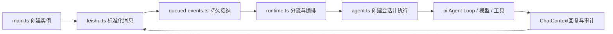

# LightClaw 源码学习路线

从一条普通私聊消息开始，不需要先读整个monorepo。入口：仓库README → project-scope.zh-CN.md → deployment.zh-CN.md。先保留正在使用的.env和控制目录；学习实验另用虚构文件与临时目录。六项功能的实现、验证与限制先对照[核心能力核对说明](core-capabilities-verified.zh-CN.md)。

## 先建立三层边界

- packages/lightclaw：本项目的平台接入、编排、目标、队列、权限策略、恢复、提示词卡片与运维。
- packages/agent与packages/ai：pi提供Agent循环、模型接口与流式事件；不是LightClaw从零实现。
- packages/coding-agent：pi提供会话、上下文压缩、资源加载和认证等基础设施；先理解调用点，再追实现。

学习目标是解释状态和数据怎样变化，而不是记住所有类名。历史实验和退役框架不属于当前学习主线。

## 第一遍：追踪一条消息

按顺序打开：

1. src/main.ts：读parseArgs、配置加载、HTTP初始化、沙箱检查、createLightClawRuntime、信号退出。解释为何直接入口不读.env，启动器脚本却会读。
2. src/transport.ts：先看ChatEvent、ChatTransport、ChatHandler、ChatContext。画出平台message ID如何进入统一ts，user/origin为什么不能靠模型文本伪造。
3. src/feishu.ts：读FeishuBot.start、消息接收/卡片回调、prepareEvent；不必先背SDK细节。对照src/slack.ts看两平台差异止于何处。
4. src/queued-events.ts与channel-queue.ts：看接纳、启动、完成、过期与队列满，区分“回调已收到”和“任务已完成”。
5. src/runtime.ts：从createLightClawRuntime的handler.handleEvent读起，区分管理命令、提示词表单、普通任务和内部目标续跑。找到createChatContext，追respond怎样发送与记录。
6. src/agent.ts：依次读resolveModel、createAgentRunner、buildSystemPrompt、返回对象里的run。追session.prompt与流事件，区分模型结果、工具结果和最终平台回复。

完成练习：不改源码，用自己的话写出“消息 → 队列 → 模型 → 工具 → 回复”每一步的输入、输出和负责文件。

## 第二遍：模型为什么能调用工具

读src/tools/index.ts，再选read.ts和bash.ts，最后看write/edit/attach。找到schema、execute与Executor。追sandbox.ts的host/Docker分支。模型只提议工具参数；真正读写和运行命令的是宿主代码/执行器。

再看policy/decide.ts、capabilities.ts、approvals.ts与authorization.ts。分清：任务授权、工具能力、危险操作票据、平台创建者。host模式使用OS用户权限，不等于Docker隔离。

练习：描述一次被拒绝的工具调用与一次需要/approve的调用。不要为了学习而对真实目录执行危险命令。

## 第三遍：上下文、记忆与提示词预览

读context.ts的syncLogToSessionManager，store.ts的频道记录，再回到agent.ts每轮buildSystemPrompt与SessionManager。比较：

| 文件/数据 | 职责 |
| --- | --- |
| log.jsonl | 可检索聊天历史，不是直接等同于本次模型请求 |
| context.jsonl | 当前会话结构化消息，可被压缩 |
| MEMORY.md | 跨会话长期偏好/事实 |
| control中的goal/inbox/approval | 确定性状态，不依赖模型记住 |

随后读prompt-rewrite.ts、prompt-input.ts的createPromptRewriter与PromptDraftStore、runtime.ts的表单分支、feishu.ts预览。明确生成器元指令、主Agent系统指令、最终用户消息是三个不同层次。原文/修改说明可落盘但不自动进入主Agent上下文，隔离不等于删除记录。

练习：解释offered → running → preview → running → consumed，以及什么时候会failed；说清为何确认前不会启动Agent、为何用户编辑不再二次改写。

## 第四遍：长期目标怎样跨多轮推进

读goals/types.ts、store.ts、commands.ts，再读verifier.ts/acceptance.ts/artifact.ts。回runtime.ts看目标续跑条件、失败/停滞暂停、awaiting_confirmation。

区分单次Agent run和跨run的目标状态机。自然语言目标申请完成后等待创建者；自动规则读真实产物/运行预定命令。验收是当前任务的完成条件，不是对Agent做学术评测。

练习：画出active/paused/awaiting_confirmation/completed/cancelled的迁移，标明每个迁移由谁触发。

## 第五遍：崩溃、取消和不确定结果

读durable-inbox.ts、durable-state.ts、operations.ts、recovery-control.ts、health.ts。先理解为什么不能“重启就再执行一次”，再看实例锁和Docker supervisor的细节。

练习：比较queued、running、unknown/completed；解释请求已发出但回复超时为何不能直接认定未执行。对照recovery.zh-CN.md，不自行删除账本。

再读scripts/state-backup.py的backup/verify/restore与test/backup-restore.test.ts。区分消息消费恢复和文件备份恢复；理解停机锁、双根目录、哈希清单、不覆盖目标，以及凭证过滤仅按文件名/扩展名。当前没有自动定时备份。

## 第六遍：用工程测试理解设计

优先阅读这些保留下来的回归文件，不需要运行效果评测：

- test/session-memory.test.ts：两级文件记忆刷新、Runner重建恢复与频道私有边界。
- test/platform-contract.test.ts：适配器与编排边界。
- test/agent-runner.test.ts：真实调用链中的faux模型与工具。
- test/prompt-redesign.test.ts、prompt-card.test.ts：候选约束与确认状态。
- test/runtime-goal-loop.test.ts、goal-terminal-delivery.test.ts：跨轮目标与最终通知。
- test/recovery-control.test.ts、inbox-lifecycle.test.ts：未知结果与人工恢复。
- test/backup-restore.test.ts：实际Python双根备份恢复、锁与损坏校验。
- test/product-scope.test.ts：产品不再依赖被删除的评测模块。

遵循AGENTS.md：静态检查用npm run check；需要运行时只选明确授权的测试文件，从packages/lightclaw执行。不要直接跑npm test/build/dev；部分历史发布测试会触发构建，阅读不等于获准执行。

## 学完后的自检

能回答：模型与harness分别做什么？一个session与一次run有何区别？记忆和目标状态为什么分开？谁决定真正完成？谁执行Shell？失败后能否重放？提示词优化在哪里隔离？上游pi与本项目各负责哪层？

能沿源码证明这些答案，再考虑做一个小改动。当前功能范围已冻结，不必通过继续堆功能才开始学习。
